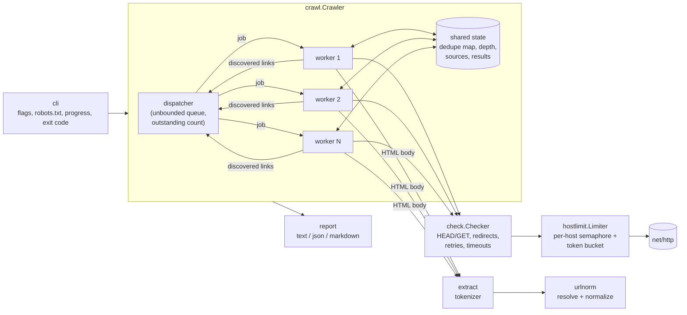

# linkpulse

A fast, polite, concurrent broken-link checker for websites and CI pipelines.

[](https://github.com/marcus-girolneto/linkpulse/actions/workflows/ci.yml)
[](https://pkg.go.dev/github.com/marcus-girolneto/linkpulse)
[](https://goreportcard.com/report/github.com/marcus-girolneto/linkpulse)
[](LICENSE)

```sh
linkpulse https://example.com
```

linkpulse crawls every page on a site, checks every link it finds (internal
pages, images, scripts, stylesheets and outbound links) and tells you exactly
which links are broken and **which pages they were found on**. It ships as a
single static binary and fits into CI: it can print Markdown for PR comments
and exits non-zero when it finds broken links.

## Why

Links rot. Documentation sites, blogs and marketing pages slowly pile up 404s,
moved pages and dead external references. Most link checkers either crawl
sequentially, which is too slow for a site with thousands of links, or fan out
without limits and get rate-limited or blocked by the servers they check.
linkpulse aims for both speed and politeness: a bounded worker pool for
throughput, plus per-host rate and concurrency limits so the target site, and
every site it links to, is treated considerately.

## Features

- **Concurrent crawl** with a bounded worker pool (`--workers`) and a
  dispatcher that never deadlocks while workers enqueue new links.
- **Per-host politeness**: token-bucket rate limit (`--rate`) and concurrency
  cap (`--host-concurrency`) for every host, with support for `Crawl-delay`.
- **robots.txt** and `<meta name="robots" content="nofollow">` respected
  (RFC 9309 wildcards and longest-match precedence); `--no-robots` turns this off.
- **HEAD first, GET to confirm**: assets and outbound links are checked with
  HEAD, and any failure is confirmed with GET before it is reported.
- **Redirect tracking**: full redirect chain, loop detection, `--max-redirects`,
  and an optional redirects report (`--show-redirects`).
- **Retries** with exponential backoff and jitter for timeouts, connection
  resets, 429 and 502/503/504, honoring `Retry-After`.
- **URL normalization and dedupe**: fragments stripped, relative references
  and `<base href>` resolved, scheme and host lowercased, default ports removed.
  Every unique URL is checked once, no matter how many pages link to it.
- **Scope control**: `--depth`, `--max-pages`, `--include` and `--exclude`
  regexes, `--internal-only`.
- **Three output formats**: a terminal table (colorized only on a TTY,
  respects `NO_COLOR`), `--format json` for scripts, and `--format markdown`
  for PR comments and job summaries.
- **CI-friendly exit codes**: `--fail-on broken|redirect|none`.
- **Clean Ctrl-C**: in-flight requests are canceled and a partial report is
  still printed (exit code 130). A second Ctrl-C quits immediately.
- Live progress on stderr when it is a terminal, a custom `--user-agent`,
  and `HTTP(S)_PROXY` support.

## Quick start

```sh
# Homebrew (macOS / Linux)
brew install --cask marcus-girolneto/tap/linkpulse

# Go toolchain
go install github.com/marcus-girolneto/linkpulse/cmd/linkpulse@latest

# Container image built from this repository
docker build -t linkpulse . && docker run --rm linkpulse https://example.com
```

Prebuilt archives for Linux, macOS and Windows (amd64 and arm64) are attached
to every [GitHub release](https://github.com/marcus-girolneto/linkpulse/releases).

## Usage

```text
linkpulse [flags] <url>
```

| Flag | Default | Description |
|------|---------|-------------|
| `--depth` | `5` | Link depth to crawl from the start page (`0` = start page only, `-1` = unlimited) |
| `--max-pages` | `1000` | Maximum pages to fetch and parse (`0` = unlimited) |
| `--workers` | `32` | Concurrent checks across all hosts |
| `--host-concurrency` | `4` | Concurrent requests per host |
| `--rate` | `10` | Requests per second per host (`0` = unlimited) |
| `--timeout` | `10s` | Timeout for one request attempt, body included |
| `--retries` | `2` | Retries for transient failures |
| `--max-redirects` | `10` | Redirects followed per link |
| `--include` | | Only crawl pages matching this regex (repeatable); links on them are still checked |
| `--exclude` | | Skip URLs matching this regex entirely (repeatable) |
| `--internal-only` | `false` | Do not check links to other hosts |
| `--no-robots` | `false` | Ignore robots.txt and meta robots `nofollow` |
| `--user-agent` | `linkpulse/<version> (+repo URL)` | User-Agent header |
| `--format` | `text` | `text`, `json` or `markdown` |
| `--output` | stdout | Write the report to a file |
| `--show-redirects` | `false` | List redirected links in text and Markdown output |
| `--fail-on` | `broken` | Exit 1 on `broken`, `redirect` (broken or redirected) or `none` |
| `--color` | `auto` | `auto`, `always` or `never` |
| `--quiet` | `false` | No progress line on stderr |
| `--version` | | Print version and exit |

Flags may appear before or after the URL. A bare host such as `example.com`
is treated as `https://example.com/`.

**Exit codes:** `0` no failures, `1` failures found (per `--fail-on`), `2`
usage or setup error, `130` interrupted (a partial report is still printed).

### Demo

Below is real output against a small local test site (`127.0.0.1:8080`)
seeded with typical problems: a missing page linked from two places, a
missing image, an API endpoint returning 500, a page that never responds, a dead download mirror, a moved page and a
robots-disallowed `/admin/` area.

```console
$ linkpulse --timeout 2s --show-redirects http://127.0.0.1:8080/
linkpulse http://127.0.0.1:8080/
7 pages crawled, 19 links checked in 7.67s

Broken links (5)

  STATUS              URL                                            FOUND ON
  500                 http://127.0.0.1:8080/api/v1/status            http://127.0.0.1:8080/docs/config
  404                 http://127.0.0.1:8080/docs/advanced            http://127.0.0.1:8080/docs/ (+1 more)
  404                 http://127.0.0.1:8080/img/install-diagram.png  http://127.0.0.1:8080/docs/install
  timeout             http://127.0.0.1:8080/reports/annual           http://127.0.0.1:8080/blog/2025-launch
  connection refused  http://127.0.0.1:9/mirror/v2.tar.gz            http://127.0.0.1:8080/docs/config

Redirects (1)

  STATUS  URL                             TARGET
  301     http://127.0.0.1:8080/old-docs  http://127.0.0.1:8080/docs/

20 links: 14 ok, 5 broken, 1 redirected, 1 skipped
$ echo $?
1
```

The 7.67s is almost entirely the deliberately unresponsive page: three
attempts (`--retries 2`) at a 2-second timeout each, plus backoff. Everything
else finished in well under a second.

Pressing Ctrl-C partway through (here with `--rate 2` to slow things down)
still produces a report:

```console
$ linkpulse --rate 2 http://127.0.0.1:8080/
^C
linkpulse http://127.0.0.1:8080/
3 pages crawled, 8 links checked in 1.53s

Interrupted: partial results, 6 links not checked.
15 links: 8 ok, 0 broken, 0 redirected, 1 skipped
$ echo $?
130
```

A real public site, checking only the links on the [go.dev](https://go.dev/)
home page (`--depth 0`):

```console
$ linkpulse --depth 0 https://go.dev/
linkpulse https://go.dev/
1 page crawled, 153 links checked in 11.94s

Broken links (8)

  STATUS  URL                                                                                                 FOUND ON
  403     https://blog.x.com/engineering/en_us/a/2015/handling-five-billion-sessions-a-day-in-real-time.html  https://go.dev/
  404     https://eng.uber.com/aresdb/                                                                        https://go.dev/
  403     https://invite.slack.golangbridge.org/                                                              https://go.dev/
  403     https://medium.com/capital-one-tech/a-serverless-and-go-journey-credit-offers-api-74ef1f9fde7f      https://go.dev/
  403     https://medium.com/netflix-techblog/application-data-caching-using-ssds-5bf25df851ef                https://go.dev/
  403     https://medium.com/tech-at-wildlife-studios/pitaya-wildlifes-golang-go-af57865f7a11                 https://go.dev/
  403     https://stackoverflow.com/questions/tagged/go?tab=Newest                                            https://go.dev/
  403     https://stackoverflow.com/tags/go                                                                   https://go.dev/

153 links: 145 ok, 8 broken, 25 redirected, 0 skipped
```

Two lessons from this run. First, the 403s come from bot protection: those
sites return 403 to any non-browser client, whatever the method or
User-Agent. In CI, add `--exclude 'medium\.com|stackoverflow\.com'` for such
hosts. Second, the ~12s is the politeness budget at work: about 100 of the
links point back at go.dev, and the default `--rate 10` spaces them out. Use
`--rate 0` against infrastructure you own.

### JSON

`--format json` emits every unique URL with its state, so it is easy to
post-process with `jq`:

```console
$ linkpulse --timeout 2s --format json http://127.0.0.1:8080/ | jq '.summary'
{
  "pages": 7,
  "total": 20,
  "ok": 14,
  "broken": 5,
  "redirected": 1,
  "skipped": 1,
  "unchecked": 0
}
$ linkpulse --timeout 2s --format json http://127.0.0.1:8080/ \
    | jq '.links[] | select(.url | endswith("/api/v1/status"))'
{
  "url": "http://127.0.0.1:8080/api/v1/status",
  "state": "broken",
  "status": 500,
  "internal": true,
  "page": false,
  "depth": 3,
  "method": "GET",
  "attempts": 1,
  "duration_ms": 499,
  "found_on": [
    {
      "page": "http://127.0.0.1:8080/docs/config",
      "tag": "a",
      "attr": "href"
    }
  ],
  "found_on_count": 1
}
```

`state` is one of `ok`, `broken`, `skipped` or `unchecked`.

### Markdown

`--format markdown` is designed for PR comments and `$GITHUB_STEP_SUMMARY`.
Here is the same run, rendered:

> ## linkpulse report
>
> Checked `http://127.0.0.1:8080/`: 7 pages crawled, 19 links checked in 7.59s.
>
> | Total | OK | Broken | Redirected | Skipped | Unchecked |
> |------:|---:|-------:|-----------:|--------:|----------:|
> | 20 | 14 | 5 | 1 | 1 | 0 |
>
> ### Broken links (5)
>
> | Status | URL | Found on |
> |--------|-----|----------|
> | 500 | `http://127.0.0.1:8080/api/v1/status` | `http://127.0.0.1:8080/docs/config` |
> | 404 | `http://127.0.0.1:8080/docs/advanced` | `http://127.0.0.1:8080/docs/`<br>`http://127.0.0.1:8080/blog/2025-launch` |
> | 404 | `http://127.0.0.1:8080/img/install-diagram.png` | `http://127.0.0.1:8080/docs/install` |
> | timeout | `http://127.0.0.1:8080/reports/annual` | `http://127.0.0.1:8080/blog/2025-launch` |
> | connection refused | `http://127.0.0.1:9/mirror/v2.tar.gz` | `http://127.0.0.1:8080/docs/config` |

## Using it in CI (GitHub Actions)

This workflow downloads a released binary, verifies its checksum, checks the
site, adds the report to the job summary and, on pull requests, comments
with the broken links:

```yaml
name: links

on:
  pull_request:
  schedule:
    - cron: "0 6 * * 1" # every Monday, catches external link rot

jobs:
  linkpulse:
    runs-on: ubuntu-latest
    permissions:
      contents: read
      pull-requests: write
    env:
      LINKPULSE_VERSION: 0.1.0
    steps:
      - name: Install linkpulse
        run: |
          base="https://github.com/marcus-girolneto/linkpulse/releases/download/v${LINKPULSE_VERSION}"
          archive="linkpulse_${LINKPULSE_VERSION}_linux_amd64.tar.gz"
          curl -sSfLO "${base}/${archive}"
          curl -sSfLO "${base}/checksums.txt"
          sha256sum --check --ignore-missing checksums.txt
          sudo tar -xzf "${archive}" -C /usr/local/bin linkpulse
          linkpulse --version

      - name: Check links
        run: |
          linkpulse --quiet --format markdown --output linkpulse.md \
            --exclude 'medium\.com|stackoverflow\.com|linkedin\.com' \
            https://docs.example.com

      - name: Job summary
        if: always()
        run: cat linkpulse.md >> "$GITHUB_STEP_SUMMARY"

      - name: Comment on the pull request
        if: failure() && github.event_name == 'pull_request'
        env:
          GH_TOKEN: ${{ github.token }}
        run: |
          gh pr comment "${{ github.event.pull_request.number }}" \
            --repo "${{ github.repository }}" --body-file linkpulse.md
```

To check a site before it is deployed, build it in the same job, serve it
locally (for example `python3 -m http.server -d public 8080 &`) and run
`linkpulse --rate 0 http://localhost:8080/`.

## Architecture



1. The CLI fetches `robots.txt` for the start host and wires the dependencies:
   one `http.Client`, one `hostlimit.Limiter`, one `check.Checker`.
2. The dispatcher hands jobs to a fixed pool of workers. A job is either a
   **check** (HEAD, confirmed with GET) or a **crawl** (GET, then parse).
3. Workers send newly discovered links back to the dispatcher. Each link has
   already been normalized and deduplicated against the shared state.
4. When the outstanding count reaches zero, or the context is canceled,
   workers drain and the report is rendered.

Packages, in dependency order: `urlnorm`, `extract`, `robots`, `hostlimit`
(no internal dependencies), then `check`, then `crawl`, `report` and `cli`.
Interfaces are defined where they are consumed: `crawl.Checker`,
`crawl.RobotsPolicy` and `check.Gate`. Tests can substitute fakes without a
mocking framework.

## Design decisions and trade-offs

**Worker pool rather than a goroutine per link.** Goroutines are cheap; sockets,
file descriptors, DNS lookups and remote servers' patience are not. A
goroutine per link means a page with 2,000 links opens up to 2,000
connections at once. A fixed pool puts one global bound on all of that.
The subtle part is that workers both consume and produce jobs: if they
pushed discoveries into a bounded channel that only they drain, the pool
could deadlock. A single dispatcher goroutine therefore owns an unbounded
slice queue, and `select`s between handing out the next job and receiving
results. It counts outstanding jobs, so completion detection needs no
`WaitGroup` races or sentinel jobs. The queue holds pointers to entries that
the dedupe map keeps anyway, so it adds little memory.

**Per-host politeness: a semaphore plus a token bucket.** The global pool
controls *our* resource use. Per-host limits control the load *we impose*
on each server. Every host gets a concurrency semaphore (`--host-concurrency`)
and an `x/time/rate` limiter (`--rate`). The slot is taken *before* waiting
for a token, so a burst of waiters cannot drain the bucket and then hit the
host all at once. A `Crawl-delay` in robots.txt lowers the start host's rate,
and never raises it. The known trade-off is head-of-line blocking: a worker
waiting for a busy host holds a pool slot that could serve another host. With
the defaults (32 workers, 4 per host) a site whose links mostly point at
itself runs at 4 concurrent requests, which is exactly the intent. A
mixed-host crawl may leave a little throughput unused. Per-host queues
would remove that (see the roadmap) at the cost of more complex scheduling.

**HEAD first, GET to confirm.** For assets and outbound links we only need the
status, so HEAD saves downloading images, archives and videos. HEAD support
in the wild is uneven, though. 405 and 501 are the documented signals, but
during development `https://bsky.app/profile/golang.org` answered HEAD with
**404** and GET with **200**. So any HEAD error status (except 429, which asks
us to back off) is confirmed with a GET before it is reported. The extra
request only happens for links that look broken, which are a small fraction
of the total. Same-host pages within the crawl scope skip HEAD entirely,
because their body is needed anyway.

**Following redirects by hand.** The `http.Client` is configured with
`ErrUseLastResponse`, and the checker walks the chain itself. That makes it
possible to report every hop, detect loops precisely (a URL repeating in the
chain) instead of only "too many redirects", resolve relative `Location`
headers through the same normalizer, and apply per-host politeness to each
hop, which may land on a different host.

**Tokenizer, not DOM.** `extract` streams through `x/net/html`'s tokenizer and
reads only the attributes it needs, into fixed struct fields instead of a map.
On a 92 KB synthetic page with 1,000 links it is **1.6x faster than
`html.Parse` plus a tree walk, with about a third of the allocated bytes**
(see benchmarks). The cost is that we never see the tree, so features such as
"links inside `<noscript>` only" are out of reach. A link checker does not
need them.

**Conservative URL normalization.** Fragments are stripped, scheme and host
are lowercased, default ports and trailing host dots are removed, dot segments
are resolved and an empty path becomes `/`. Query parameter order, path case
and trailing slashes are left alone, because servers legitimately treat
`/Docs` and `/docs`, or `/a` and `/a/`, as different resources. A fuzz test
asserts that normalization is idempotent and always yields a re-parseable
http(s) URL. Within seconds it found three real bugs (IPv6-looking hosts, raw
spaces in queries, hosts made only of dots). Those inputs are now part of the
committed corpus in `internal/urlnorm/testdata/fuzz`.

**robots.txt applies to the site being crawled.** robots.txt governs
automated crawling. Fetching one robots.txt per outbound host, just to send
a single HEAD request that a human clicking the link would also cause, would
double the request count for little benefit. So linkpulse honors the start
host's robots.txt for every same-host request, including the `Allow`/`Disallow`
wildcards, longest-match precedence, `Crawl-delay` and meta `nofollow`.
Following RFC 9309, a 4xx robots.txt means "no restrictions" and a 5xx means
"disallow everything". The latter prints a warning that points at `--no-robots`.

**Cancellation that does not lie.** On Ctrl-C the dispatcher stops handing out
work and every in-flight request is canceled through its context. A check
interrupted that way is reported as *unchecked*, not *broken*, so a partial
report never contains false positives. The first signal also restores
default signal handling, so a second Ctrl-C exits immediately.

**Stable error vocabulary.** Transport errors are mapped to short phrases
(`timeout`, `connection refused`, `dns: no such host`,
`tls: certificate expired`, `redirect loop`, and so on) using `errors.Is` and
`errors.As` on the underlying types. Report columns stay readable and the
JSON is easy to filter.

**What breaks at scale.** All state lives in memory and grows linearly with
the number of unique URLs (plus up to 25 referring pages per URL). That is
fine for sites with hundreds of thousands of links, but not for crawling the
web. There is no persistent cache between runs, so
every scheduled CI run re-checks every external link. Links that only appear
after JavaScript runs are invisible. Bot-protected hosts answer 403 to any
non-browser client and have to be excluded.

## Testing

```sh
make test     # go test -race ./...
make cover    # coverage summary
make lint     # golangci-lint (errcheck, govet, staticcheck, revive, gosec, errorlint, bodyclose, noctx, ...)
make fuzz     # 30s each for the URL normalizer and robots.txt parser
make bench    # all benchmarks
make golden   # regenerate golden files after an intentional output change
```

What is covered:

- **`urlnorm`**: a table of 30+ cases (relative resolution, ports, IPv6,
  unsupported schemes, whitespace) plus a fuzz test for idempotence.
- **`extract`**: golden files in `testdata/` for a realistic blog page, malformed
  HTML and a nofollow page, plus table tests for edge cases (unquoted and
  duplicate attributes, entities, comments, inline scripts, `srcset`, `<base>`).
- **`robots`**: group selection, wildcards, `$` anchors, precedence ties,
  `Crawl-delay`, status handling against `httptest`, plus a fuzz test.
- **`hostlimit`**: concurrency cap under contention, measured rate, host
  isolation, context cancellation without leaking slots, `Crawl-delay`
  slow-down.
- **`check`**: HEAD fallback (405, 501 and HEAD-only 404), redirect chains and
  loops, retries with `Retry-After`, timeouts, connection refused, body
  limits, content sniffing and permit release, all against `httptest`.
- **`crawl`**: an `httptest` site with cycles, redirects, 404s, 500s, a slow
  page, robots.txt, a nofollow page and a second "external" server. It
  asserts each page is fetched once, sources are tracked, depth, include,
  exclude and max-pages limits hold, the crawl follows a start-URL redirect
  to a new host, and cancellation yields unchecked rather than broken links.
- **`report`**: golden files for every format (text, ANSI-colored text, JSON,
  Markdown) across broken, clean and interrupted reports. Run
  `go test ./internal/report -update` to accept changes.
- **`cli`**: end-to-end runs against `httptest` covering exit codes, flag
  validation, color selection (TTY, `NO_COLOR`, `--color`), `--output`,
  progress output and interruption.

Coverage of `internal/...` is **95.9%** of statements (`check` 93.2%, `cli`
97.0%, `crawl` 94.5%, `extract` 98.5%, `hostlimit` 100%, `report` 96.1%,
`robots` 96.1%, `urlnorm` 100%). Everything passes under `-race`.

## Benchmarks

Measured on an Apple M2 Max (Apple Silicon), Go 1.27, `go test -bench . -benchmem`.

**Crawl throughput** (`internal/crawl`): a local `httptest` site with 500
pages, each linking to 11 other pages and 5 shared assets. A full crawl
fetches and parses 500 pages and checks 505 unique URLs. The latency variant
delays every response by 5 ms to model a remote server.

| Server latency | Workers | Time per crawl | Pages/s |
|---|---:|---:|---:|
| 0 (loopback) | 1 | 54 ms | 9,197 |
| 0 (loopback) | 8 | 44 ms | 11,276 |
| 0 (loopback) | 32 | 48 ms | 10,390 |
| 5 ms | 1 | 3.16 s | 158 |
| 5 ms | 8 | 371 ms | 1,348 |
| 5 ms | 32 | 103 ms | 4,839 |

On loopback the crawl is CPU-bound, because client and server share the
process, and extra workers barely help. With realistic latency the pool
scales almost linearly with workers (30x from 1 to 32), which is the reason
it exists. Per-host limits in these runs equal the worker count. With
politeness defaults, throughput against a single host is bounded by
`--rate`, by design.

**Link extraction** (`internal/extract`): a 92 KB page with 1,000 links.

| Benchmark | Time/op | Throughput | Bytes/op | Allocs/op |
|---|---:|---:|---:|---:|
| `Links` (tokenizer, fixed attribute fields) | 0.70 ms | 132 MB/s | 249 KB | 12,043 |
| `Links` before switching from a map to fixed fields | 0.89 ms | 104 MB/s | 606 KB | 17,050 |
| `html.Parse` + tree walk (baseline) | 1.11 ms | 83 MB/s | 705 KB | 22,560 |

Most of the remaining allocations happen inside the `x/net/html` tokenizer
itself.

**Per-host limiter** (`internal/hostlimit`): `Acquire` plus `release` with
rate limiting disabled, in parallel: 273 ns/op, 2 allocs/op.

## Project layout

```text
.
├── cmd/linkpulse/          # main: signals, TTY detection, build info
├── internal/
│   ├── cli/                # flags, wiring, progress line, exit codes
│   ├── crawl/              # dispatcher + worker pool, dedupe, depth, robots, report model
│   ├── check/              # HTTP checks: HEAD/GET, redirects, retries, error vocabulary
│   ├── hostlimit/          # per-host semaphore + token bucket
│   ├── extract/            # streaming link extraction (golden files in testdata/)
│   ├── robots/             # robots.txt parser and fetcher (RFC 9309)
│   ├── report/             # text, JSON and Markdown renderers (golden files in testdata/)
│   └── urlnorm/            # URL resolution and normalization (fuzz corpus in testdata/)
├── .github/workflows/      # ci.yml, release.yml
├── .goreleaser.yaml        # cross-platform builds, archives, checksums, Homebrew cask
├── .golangci.yml
├── Dockerfile              # distroless, non-root, ~16 MB
└── Makefile
```

## Releasing

Pushing a `v*` tag runs GoReleaser, which builds Linux, macOS and Windows
binaries for amd64 and arm64, injects the version via `-ldflags`, and publishes
archives and `checksums.txt` to a GitHub release. The Homebrew cask is pushed
to `marcus-girolneto/homebrew-tap` only when the `HOMEBREW_TAP_GITHUB_TOKEN`
secret is configured, so releases succeed before the tap exists. Pre-releases
are never pushed to the tap. Locally, `make snapshot` builds everything into
`dist/`.

## Roadmap and limitations

- **Per-host work queues** to remove head-of-line blocking when one host is
  saturated.
- **`--accept` status list** (for example to treat 403 from known
  bot-protected hosts as OK instead of excluding them).
- **Sitemap seeding** (`sitemap.xml`) and checking links in non-HTML documents
  (CSS `url()`, Markdown sources).
- **Anchor checking**: verify that `#fragment` targets exist on the page.
  Fragments are currently stripped.
- **Persistent cache** of external results between CI runs, with a TTL.
- JavaScript-rendered links are not discovered. A headless browser is out of
  scope for a single static binary.
- Tests run on Linux and macOS. Windows binaries are cross-compiled but not
  tested in CI, and some transport errors are worded differently there, for
  example `connection refused`.

## License

[MIT](LICENSE) © 2026 Marcus Vinicius Girolneto Sousa
